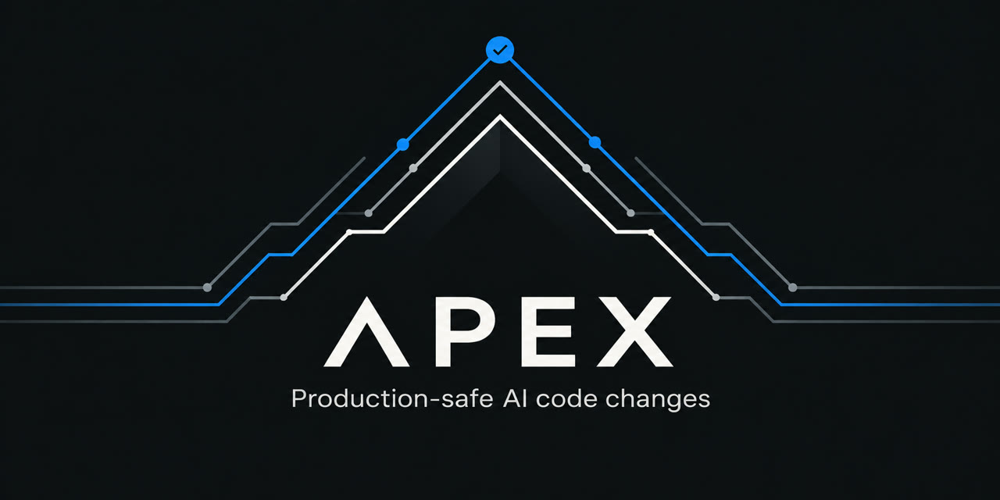

# ⚡ Apex — Production-safe AI Coding Workflow

> **Apex helps coding agents understand the task, change only what matters, verify the result, and report evidence.**

Current release: `apex-core@7.0.0`

**[English](README.md) · [ภาษาไทย](README.th.md)**

Apex is a disciplined, local operating protocol and rule specification for AI coding agents. It provides structured operational guardrails—intent locking (read-only investigation vs. surgical patching vs. guarded destructive operations), targeted in-RAM verification, and mandatory evidence delivery—to guide coding agents when inspecting, modifying, and testing code in existing software repositories.

**v7.0.0** adds adaptive system building: scope and design proportional to uncertainty and risk, dependency-aware implementation, and acceptance evidence. It keeps the Micro-Kernel, JIT stack adapters, and low-risk patch fast track.

---

## 🏛️ Apex v7.0.0 Architecture

Apex v7.0.0 separates core behavioral invariants, universal engineering principles, and domain-specific stacks into distinct, composable layers:

```text
┌────────────────────────────────────────────────────────────────────────────────────────┐
│                              APEX v7.0.0 KERNEL ARCHITECTURE                             │
├────────────────────────────────────────────────────────────────────────────────────────┤
│ 1. ROOT MICRO-KERNEL (AGENTS.md · under 6 KB · measured by npm test)                       │
│    ├── [R0] Grounding & Anti-Sycophancy: Senior Engineer objectivity, BLUF, Direct      │
│    ├── [R1] 3-Tier Dynamic Intent & Tiered Planning Gate (Tier A vs Tier B docs/plans/)   │
│    ├── [R2] In-RAM Fast Targeted Feedback: Native host check (pnpm, pytest -q, dotnet)  │
│    ├── [R3] Strict Seam Binding: [Test] | [Compiler] | [Syntax-Only] | [Unverified-UI]   │
│    └── [R4] Surgical Diffs & Anti-Pollution: DPR = 1.0, Zero scratch files in target repo│
├────────────────────────────────────────────────────────────────────────────────────────┤
│ 2. UNIVERSAL PRINCIPLES (core/principles.md)                                           │
│    ├── Universal Security Baseline (Server authority, session guards, secret redact)   │
│    ├── Fail-Fast Error Boundaries & Standardized Error Envelopes                       │
│    ├── Git Discipline & Atomic Commit Standards (English only, BLUF, DPR = 1.0)        │
│    └── Architecture Bounds: Monolith-First, YAGNI, Pragmatic OOP & Rule of Three        │
├────────────────────────────────────────────────────────────────────────────────────────┤
│ 3. JIT MODULAR STACK ADAPTERS (adapters/*.md)                                          │
│    ├── adapters/web-fullstack.md (Nuxt 4 / Next 15, Tailwind, 4-State UI, Responsive)  │
│    ├── adapters/backend-data.md  (Node/Prisma 7, Postgres, OCC version, 5s Tx, Security)│
│    └── adapters/polyglot-core.md (Python 3.10+ FastAPI/mypy, C# .NET 8, Shell/POSIX)   │
├────────────────────────────────────────────────────────────────────────────────────────┤
│ 4. DETERMINISTIC ADAPTER BUS & RISK-OVERRIDE DISPATCHER                                │
│    ├── Fast Track (1–3 files, Low Risk) ──> Zero Adapter Loading (Micro-Kernel only)    │
│    └── High-Risk Override Gate ────────────> Required Adapter Loading:                  │
│        (Auth/RBAC, Money/PII, Schema/DB, Concurrency/OCC, Contested State, API Contract)│
├────────────────────────────────────────────────────────────────────────────────────────┤
│ 5. BUILD WORKFLOW: skills/apex-core/references/build-workflow.md                     │
│    Discovery -> Design -> Plan -> Implement/Verify -> Acceptance Review              │
├────────────────────────────────────────────────────────────────────────────────────────┤
│ 6. DUAL-SPEED ENVIRONMENT & PRODUCTION DEVOPS                                          │
│    ├── Host Execution: Node 22, pnpm, Python uv, .NET 8 on Windows Host (In-RAM 1-3s)  │
│    ├── Stateful Infra: PostgreSQL 17 + Redis 7 in Docker Compose (compose.dev.yaml)     │
│    ├── Fail-Fast CI: 4-Stage GitHub Actions (Lint -> TypeCheck -> FastTest -> Audit)   │
│    └── Dual Health Probes: /api/health/live (Process state) vs /ready (DB Pool + Redis)│
└────────────────────────────────────────────────────────────────────────────────────────┘
```

---

## What Apex is

Apex is an engineering protocol that governs how an AI coding agent approaches a codebase:
- **Disciplined Execution Protocol:** Defines clear intent tiers (read-only audits, surgical bug fixes, synthesis builds, and guarded destructive blast-radius gates) so the agent never oversteps the user's intent.
- **Surgical Code Modifications:** Enforces minimal, targeted diffs and prevents drive-by refactoring of unrelated files or unnecessary dependencies.
- **Strict Seam Binding & Circuit Breaker:** Standardizes 4 levels of truth (`[Verified: Test]`, `[Verified: Compiler]`, `[Syntax-Only]`, `[Unverified: Visual]`) and halts runaway retry loops after two consecutive unexpected failures.
- **Evidence-First Delivery:** Requires the agent to provide concrete verification command outputs and terminal logs rather than unsupported confidence claims.

## What Apex is not

- **Not a production runtime dependency:** Apex is never imported or deployed in your application runtime. Your project retains its own dependencies, package manager, and lockfile.
- **Not an autonomous daemon or CLI that edits code independently:** Apex instructs existing AI coding assistants (such as Antigravity, Cursor, Claude Code, Windsurf) how to act.
- **Not a replacement for Git, unit tests, or peer code review:** Existing repository conventions and human engineering judgment always take precedence.
- **Not dependent on Nexus:** Apex functions 100% standalone without external memory or MCP servers. Nexus is strictly an optional companion.

---

## Production-safe changes, not plausible code

Apex is for the moment when an agent's patch must survive contact with a real repository:

| Workflow label | When to use it | What Apex insists on |
|---|---|---|
| **Patch** | A bug fix or narrow adjustment | Root cause, a surgical diff (DPR = 1.0), and a targeted regression check |
| **Build** | A new feature or cross-layer change | Explicit scope, project conventions, and the affected user path |
| **Review** | You need findings without modifying code | Read-only evidence, impact, and actionable priority |
| **Release** | Auth, money, database, PII, or shared contracts are involved | Risk-specific authorization, state, compatibility, and verification gates |

---

## System building in v7

For a new system or substantial feature, the existing entry skill loads the [Build workflow](./skills/apex-core/references/build-workflow.md). Establish scope, necessary boundaries, acceptance criteria, and a dependency-aware plan; implement and verify coherent slices, then review integration and acceptance using the existing quality-verify skill. Clear low-risk additions stay on the fast track.

Documentation follows project needs: CLI/API projects do not require a UI design system, and small projects can use one concise plan. Ask for material missing decisions; existing implementation authorization carries forward. Worktrees, subagents, and additional approval gates are not default requirements.

### Migration from v6

- Update the shared checkout or plugin as a complete release, including skill references. The five skill names and plugin skill-directory discovery are unchanged.
- Existing PRD/design/verification documents remain valid; keep useful content without forced renames or deletion.
- The single-file kernel remains a lightweight fallback. Full Build guidance requires the linked reference and quality-verify files from this repository. If unavailable, follow the kernel and state the limitation rather than inventing missing guidance.
- See the [v7 plan and migration rationale](./docs/plans/2026-10-29-apex-v7-build-workflow.md) and [validation plan](./docs/validation-plan.md). Packaging checks and static walkthroughs do not establish live agent effectiveness or comparative token savings.

---

## Getting Started: Single Universal Adoption Mode

Apex v7.0.0 unifies previous installation models into a single, zero-friction pattern:

### 1. Global Reference (Recommended for Local Dev)
Keep one shared checkout and register its root [`AGENTS.md`](./AGENTS.md) in your AI agent's system prompt or global instructions:

```bash
git clone https://github.com/AlmxndBL/Apex-core.git ~/.agents/Apex-core
cd ~/.agents/Apex-core && npm install && npm test
```

*Note:* `npm install` and `npm test` are only for running Apex's local framework integrity suite; they do not modify target projects.

### 2. Single-File Drop-in (For External Teams & Pinned Repos)
Copy only [`AGENTS.md`](./AGENTS.md) (under 6 KB) directly into the target project root (e.g. as `AGENTS.md` or `CLAUDE.md`). The Micro-Kernel contains all mandatory invariants (R0–R4) in a single compact file without requiring any vendor directories.

### First task prompt

Once Apex's instructions are available to your agent, use a normal task request:

```text
Use Apex for this task: [describe the bug, feature, or review].

Before changing code, inspect the relevant project conventions and affected flow.
Make the smallest safe change, then report the files changed, verification command,
terminal result, and any behavior that could not be verified.
```

---

## Inside Apex (v7.0.0 Directory Blueprint)

- [`AGENTS.md`](./AGENTS.md): Language-agnostic Micro-Kernel protocol and safety gates (under 6 KB)
- [`core/principles.md`](./core/principles.md): Universal engineering principles, server authority, and OOP Rule of Three
- [`adapters/`](./adapters): Pluggable modular stack adapters:
  - `web-fullstack.md`: Nuxt 4, Next.js 15, Tailwind, 4-State UI, Responsive Data Table
  - `backend-data.md`: Node, Prisma 7, PostgreSQL, OCC, 5s Tx timeout, OOP Patterns
  - `polyglot-core.md`: Python 3.10+ (FastAPI, pytest, mypy), C# .NET 8, Shell/POSIX
- [`rules/`](./rules): Legacy engineering rules (preserved with v6.0 deprecation bridges)
- [`skills/`](./skills): Specialized skills (`apex-core`, `frontend`, `backend-data`, `quality-verify`, `cartography`)
- [`templates/`](./templates): Production blueprints, DevOps and infrastructure:
  - `docker/compose.dev.yaml`: PostgreSQL 17 + Redis 7 local stack with healthchecks
  - `docker/Dockerfile.fullstack`: Multi-stage build on Node 22 slim with non-root security
  - `ci/github-ci.yml`: 4-stage fail-fast GitHub Actions workflow
  - `blueprints/healthcheck-endpoints.md`: Dual health probes (`/api/health/live` & `/ready`)

---

## Apex + Nexus 4 (Optional)

**Apex tells an agent how to work. Nexus remembers what earlier work established.**

| Question | Apex-core | Nexus 4 |
|---|---|---|
| How should this task run? | Intent, scope, safety, verification | — |
| What was already decided? | — | Project brief, ADRs, reusable lessons |
| What happens after work? | Verify and report evidence | Optional redacted session handoff |
| Where is the data? | Local instructions/tools | Local-first Markdown vault; no cloud/source upload by default |

Use Nexus only when its local MCP tools are available:
```text
1. nexus_get_project_brief({ projectId: "apex-core" })
2. Follow Apex discovery → implementation → verification
3. nexus_save_session({ project: "apex-core", filesChanged: ["relative/path.ts"] })
```

---

## Evidence and Limitations

Apex operates under an epistemic doctrine of empirical evidence over confident assertions. Consult [`EVIDENCE.md`](./EVIDENCE.md) for the complete, auditable Evidence Register.

- **Internal Framework Integrity (`Verified`):** Running `npm test` executes the local verification script (`scripts/verify-framework.js`), which validates repository structure, schema manifests, rule consistency, Micro-Kernel token budget, and document links (see the actual count in the command output). This validates **protocol packaging integrity only**; it does not measure or guarantee coding agent performance on external software tasks.
- **Historical Benchmark Metrics (`Historical / Unverified`):** Prior documentation and evaluation releases in [Apex-eval](https://github.com/AlmxndBL/Apex-eval) cited figures such as -58.4% token reduction or 100% Pass@1 accuracy. As audited in [`EVIDENCE.md`](./EVIDENCE.md), the saved benchmark artifact was generated by a deterministic mock test runner (`isMock: true`). These figures are historical artifacts of mock execution, not live agent benchmarks across arbitrary codebases.
- **Operational Proof on Your Codebase:** Real-world agent accuracy and token economy depend on the target codebase, the underlying model, prompt context, and developer review. The true measure of completion is the observable verification trail—exact command outputs, passed tests, and failure-path checks—produced directly within your repository.

---

## FAQ

### Is Apex a coding agent or a framework my application runs on?
Neither. Apex is a local operating protocol for a coding agent: instructions, focused skills, templates, and integrity checks. It adds no runtime dependency to the application you are building.

### What is the Rule of Three for Design Patterns in v7.0.0?
Never introduce design patterns preemptively (anti-overengineering/YAGNI). Patterns (Strategy, Adapter, State, Facade) may only be introduced when there are at least three distinct, concrete variants ($\ge 3$) actively in use. Manual singletons and deep inheritance (>2 levels) are strictly banned.

### How does the Dual-Speed Environment work?
Run code, package managers (`pnpm`), and typechecks directly on the Windows host for rapid in-RAM execution (1–3s). Run stateful infrastructure (PostgreSQL 17, Redis 7) inside Docker Compose (`compose.dev.yaml`) with container healthchecks.

### Does Apex replace tests, code review, or my team's conventions?
No. Existing repository conventions win. Apex helps an agent choose and run the project's relevant checks, produce useful review evidence, and avoid treating a successful happy path as proof that a change is safe.
